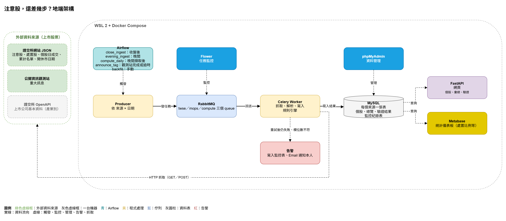
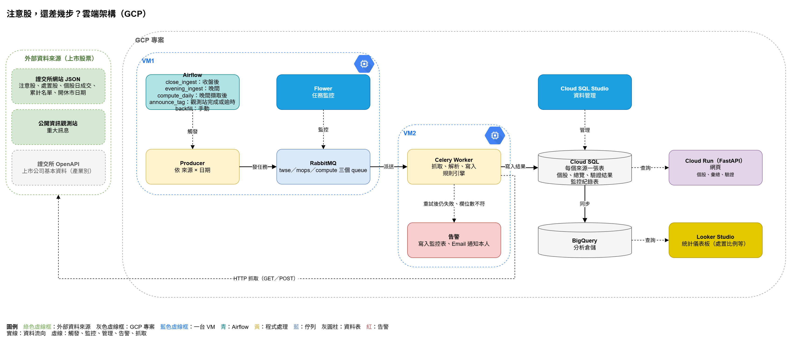

# 注意股，還差幾步？

> 證交所每天告訴你哪檔股票被列為「注意股」；這個專案告訴你**它還差幾次會變成處置股、每一步依據哪條規則、這段期間公司說了什麼**。

TibaMe 資料工程專題（NKR204），個人製作。2026/11 起實作，預計 12 月底 Demo。

---

## 這個專案在解決什麼問題

台股有一套「注意 → 處置」制度：證交所每個交易日收盤後公布注意股，其中第 1–8 款的注意次數會累計，達到門檻（連 3 日、連 5 日、10 日內 6 次、30 日內 12 次）就成為**處置股**——撮合變慢、大額委託要先預收款券。

做短線或用融資的散戶，自選股被列注意時最想知道的是：

- 這次的注意款次**會不會累計**？
- 還差幾次會被處置？計入的是哪幾天？
- 如果明天再被列注意，**從哪天開始受限、限到哪天**？
- 這段期間公司在公開資訊觀測站說了什麼？

這些資訊今天散在 4 個地方：《注意交易資訊暨處置作業要點》、證交所兩個公告頁面、觀測站逐家查詢。官方的「注意累計可能達處置標準」名單只列**只差一次**的股票，而且沒有歷史。

**本專案每個交易日替每檔注意股與處置股產生一張卡片**，只放可指回原文的事實：注意款次、四條累計路徑的進度、處置條件與措施、公司公告。每個累計數字列出計入的日期，並標示與官方名單的比對結果（官方一致／依要點推算／與官方不一致）。

**不做的事：** 不預測漲跌、不推薦買賣、不判斷是否涉及炒作。

## 產出長什麼樣

| 畫面 | 內容 |
| --- | --- |
| 個股卡片 | 今日款次、累計進度（含日期與驗證狀態）、若再列注意的處置日期、處置紀錄、近 30 個營業日公告 |
| 卡片牆 | 每間公司一張卡片；分頁：全部、注意股、聽牌、處置股、明日出關、今日出關 |
| 驗證頁 | 每日「只差一次」名單 vs 官方名單、次日處置名單 vs 官方處置公告；不一致者列出原因 |
| 統計儀表板 | 各款次進入處置的比例、有無公告的差異、產業分布 |

線框圖見 [`docs/images/`](docs/images/)，詳細定義見 [`docs/proposal.md`](docs/proposal.md) 第 5 節。

## 資料來源

全部是公開 HTTP JSON，不需登入；範圍限上市公司股票。

| 來源 | 用途 |
| --- | --- |
| 證交所 注意股 `notice` | 輸入清單、注意款次、累計計算 |
| 證交所 處置股 `punish` | 處置 tag、歷史回測的答案 |
| 證交所 注意累計名單 `notetrans` | 每日驗證（只有最新一日） |
| 證交所 開休市日期、個股日成交 | 交易日曆、臨時休市判定 |
| 證交所 OpenAPI 上市公司基本資料 | 公司股票判定、產業別 |
| 公開資訊觀測站 重大訊息 | 公司公告 tag（一次一家、一個月） |

## 架構

**地端（11 月）：** WSL 2 + Docker Compose

**雲端（12 月）：** GCP

| 環節 | 工具 |
| --- | --- |
| 擷取 | Python requests、Celery + RabbitMQ（觀測站逐家逐月查詢需限速、重試） |
| 排程 | Airflow（只做編排，抓取與規則引擎都在 worker 執行） |
| 資料庫 | MySQL → Cloud SQL；分析用 BigQuery |
| 規則引擎 | Python／pandas：連續營業日、滾動窗口、前次處置扣除 |
| 網站 | FastAPI → Cloud Run |
| 儀表板 | Metabase → Looker Studio |
| 測試 | pytest：款次解析、規則引擎（以官方處置公告為答案）、重跑冪等 |

設計原則：**每日＝回補一天**（同一套任務只差日期，重跑筆數不變）；**raw 與計算分層**（規則改了從 raw 重算，不必重抓）。
