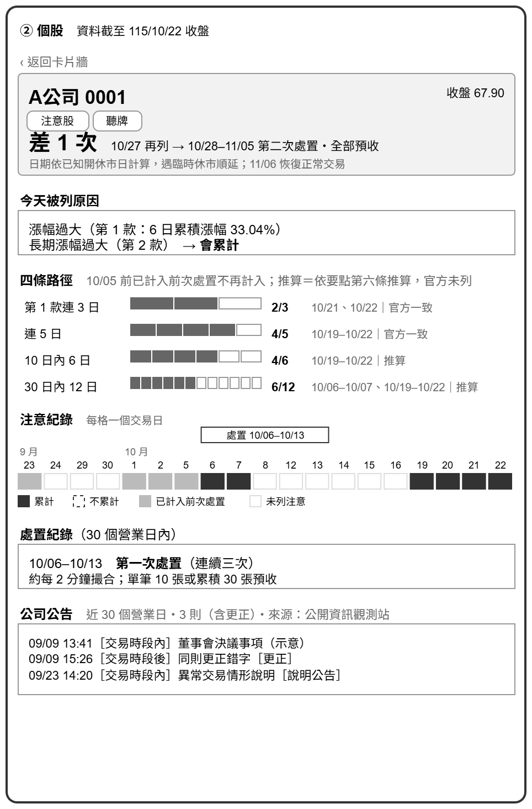
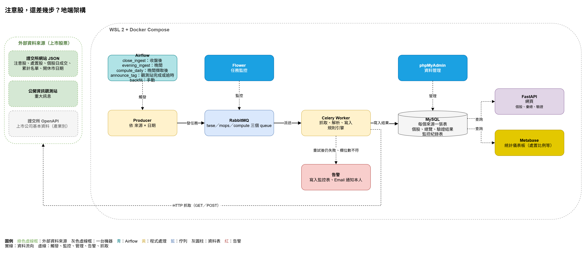

<!-- _class: lead -->
<!-- _paginate: false -->

# 注意股，還差幾步被處置？

替注意股標出處置進度與事實依據

NKR204 ・ 戴佩涵 ・ 2026/11/01

<!--
（10 秒）大家好，我的題目是「注意股，還差幾步被處置？」。我依老師給的 8 項來報告。
-->

---

# 1. 製作動機 & 業務問題

## 注意股、處置股是什麼？

- **注意股**：股價或成交量出現異常（例如 6 個營業日內漲幅過大、成交量暴增），證交所每天收盤後公布名單。**只是提醒，不限制交易**
- **處置股**：注意次數累計到門檻（例如連續 5 個營業日被列注意），證交所開始**限制交易**：約每 2 分鐘才撮合一次、大額委託要先預收款券，為期約 5 個營業日

## 投資人在意的是：明天會不會變處置股？

自選股被列注意的那個晚上，他想知道：這次會不會累計？還差幾次被處置？明天再被列，從哪天受限到哪天？

**問題**：答案散在 4 個地方（作業要點原文、證交所兩個頁面、觀測站逐家查）。官方只列「再一次就會被處置」的股票，而且只有當天；歷史注意紀錄查得到，但**哪幾次算數、已累計幾次**，要自己對照規則數

<!--
（60 秒）
先說明兩個名詞。注意股是證交所每天收盤後公布的名單，代表這檔股票的價格或成交量出現異常，例如六天內漲太多、成交量突然放大。注意股只是提醒，不限制交易。
但注意次數累計到門檻，就會變成處置股，這時才真的限制交易：撮合從即時變成約每兩分鐘一次，大額委託要先把錢或股票交出來，大約五個營業日。
所以對投資人來說，被列注意的那個晚上，真正在意的是明天會不會變處置股。
問題是答案分散在四個地方。官方只列再一次就會被處置的股票，而且只有當天；歷史注意紀錄查得到，但哪幾次算數、已經累計幾次，要自己對照規則去數。

【備註：處置規則，被問到再講】
《注意交易資訊暨處置作業要點》第六條，第 1–8 款的注意會累計，四條路徑任一條達到就處置：
- 第 1 款連續 3 個營業日
- 第 1–8 款連續 5 個營業日
- 第 1–8 款最近 10 個營業日內 6 日
- 第 1–8 款最近 30 個營業日內 12 日
第 9–14 款不累計；30 個營業日內第二次處置 → 全部委託預收。
規則是公開條文、官方每天公布處置名單 → 「還差幾次」算得出來，而且有標準答案可以驗證（這是選這題的核心理由）。
-->

---

# 2. 資料來源能取得（input）

| 來源 | 提供什麼 | API／網址 |
|---|---|---|
| **注意股**（證交所） | 每日注意名單、款次 | `twse.com.tw/rwd/zh/announcement/notice` |
| 處置股（證交所） | 處置期間與措施 | `twse.com.tw/rwd/zh/announcement/punish` |
| 只差一次名單（證交所） | 官方的累計答案 | `twse.com.tw/rwd/zh/announcement/notetrans` |
| 開休市日期（證交所） | 交易日曆 | `twse.com.tw/rwd/zh/holidaySchedule/holidaySchedule` |
| 個股日成交（證交所） | 交易日判定、收盤價 | `twse.com.tw/rwd/zh/afterTrading/MI_INDEX` |
| 重大訊息（觀測站） | 公司公告 | `mops.twse.com.tw/mops/api/t05st01`（POST） |
| 上市公司基本資料（OpenAPI） | 判定公司股票、產業別 | `openapi.twse.com.tw/v1/opendata/t187ap03_L` |

7 個已實際取得，全部回傳 JSON、不需登入

<!--
（30 秒）
這 7 個資料來源都實際打過，全部是 JSON、不需登入。
主要來源是注意股，接下來兩頁用它說明取得方式和格式。
-->

---

# 3. 資料來源的取得方式

## 注意股：帶日期區間的 GET，每日與回補用同一支網址

> GET https://www.twse.com.tw/rwd/zh/announcement/notice?response=json&querytype=1&stockNo=&selectType=&startDate=20260701&endDate=20261024&sortKind=DATE

- HTTP GET，回傳 **JSON**，不需登入、不需金鑰
- 帶 `startDate`、`endDate` → 每日更新是「回補一天」，歷史回補**一次請求**即可
- 對照：觀測站重大訊息**一次只能查一家、一個月** → 回補上千次，需要佇列、限速、失敗重派

<!--
（35 秒）
注意股是一般的 GET 請求。因為能帶日期區間，每天更新和回補歷史用同一支網址，回補一次請求就夠。
相對的，觀測站一次只能查一家一個月，回補是上千次請求，這是後面用 Celery 的理由。
-->

---

# 4. 資料來源的欄位和格式

> "fields": ["編號", "證券代號", "證券名稱", "累計次數", "注意交易資訊", "日期", "收盤價", "本益比"], "data": [[1, "0002", "B公司", "18", "最近六個營業日累積收盤價漲幅達27.14%。且10月22日之成交量為最近六十個營業日日平均成交量之10.39 倍﹝第三款﹞。且10月22日之週轉率為12.10%﹝第四款﹞。", "115.10.22", "31.50", "-----"], …]

| 欄位 | 範例 | 處理方式 |
|---|---|---|
| 編號 | `1` | 不使用 |
| 證券代號 | `"0002"` | 唯一鍵；對上市公司基本資料，只留公司股票 |
| 證券名稱 | `"B公司"` | 顯示用 |
| **當日公布筆數** （API 名稱：累計次數） | `"18"` | 同一天每筆都一樣，不是個股累計 → 個股累計自行計算 |
| 注意交易資訊 | `"…﹝第三款﹞…"` | 款次標記在**句尾**、涵蓋前面數句 → 依標記切段，一筆拆成多款 |
| 日期 | `"115.10.22"` | 唯一鍵；民國 → 西元 |
| 收盤價 | `"31.50"` | 字串 → 數字 |
| 本益比 | `"-----"` | 不用；`-----` 代表無值 |

欄名與資料分開放：`fields` 是欄名，`data` 是沒有欄名的陣列 → 依欄名對位解析　・　公司名稱為示意

<!--
（50 秒）
證交所的回傳把欄名和資料分開放，fields 是 8 個欄名，data 是一列列的值，要自己對位。
兩個坑：
第一，款次標記放在句尾。「累積漲幅 27%」看起來像第一款，其實屬於後面的第三款，要依標記切段。
第二，有一個「累計次數」欄位，名字正是我要的，但它其實是「當天公布了幾筆」。例如 10/22 每一筆都是 18，因為那天名單剛好有 18 筆。所以個股的累計要自己算。

【備註：被問到「怎麼確定」再講】
- 官方 OpenAPI 規格這個欄位的英文名稱是 NumberOfAnnouncement（公布筆數）
- 處置股用同一個英文欄名，網站上的中文標題直接寫「當日公布筆數」
- 07/01–10/24 共 78 個交易日驗證：每天這個值都等於當天名單的總筆數，0 個例外
- 官方沒有文件明寫，這是由以上三點推論
-->

---

# 5. 預期產出（output）

## 每檔注意股一張卡片，每個數字附依據

- **今日注意款次**：哪一款、會不會累計
- **累計進度**：四條路徑各差幾次，列出計入的日期
- **若明天再列**：換算成實際的處置日期與措施
- **期間內公司公告**（觀測站重大訊息）
- 每個數字標示：**官方一致／依規則推算**

另有：每日卡片牆、內部資料驗證頁、統計儀表板
不做：預測漲跌、推薦買賣、觸發價

<!--
（40 秒）
產出是每檔一張卡片，線框裡的數字是原型實際算出來的。
市面上已經有處置倒數工具，我的差別是每個數字都能指回原文和日期，並和官方名單比對。我刻意不做預測和買賣建議。
-->

---

# 6. 初步技術堆疊 & 可行性

## 預計使用的工具

| 環節 | 課程工具 |
|---|---|
| 環境 | WSL 2、uv、Docker Compose |
| 擷取 | requests、Celery、RabbitMQ、Flower |
| 儲存 | MySQL → Cloud SQL；BigQuery |
| 排程 | Airflow |
| 規則引擎 | Python（pandas）、pytest |
| 出口 | FastAPI；Metabase → Looker Studio |
| 上雲 | GCE VM、Secret Manager |

## 一個月原型回測

**做法**：抓 115/09/23–10/22（19 個交易日）的官方注意股紀錄，用 Python 照要點第六條逐日計算每檔的累計次數，再和證交所實際公布的處置名單比對

| 比對項目 | 結果 |
|---|---|
| 官方公布的 33 次處置，程式都算得到 | **33/33** |
| 程式算出會處置、官方卻沒處置 | **0 次** |
| 處置條件（連續三次、連續五次…）相同 | **33/33** |
| 10/22 官方「只差一次」名單 | **2/2 相同** |

**意義**：只用公開資料就能重現官方的判定 → 卡片上的累計進度有根據。回測也找到條文要注意的地方：**處置後要重新起算**

<!--
（70 秒）
左邊是技術堆疊，全部是課程教過的。Celery 和 RabbitMQ 是為了觀測站逐家逐月查詢，需要佇列、限速、失敗重派；規則引擎，就是照第六條算累計次數的那支程式，用 Python 寫，用官方處置公告當 pytest 的答案。
右邊是可行性，這是我最想讓老師看到的。正式開工前，我先做了一個原型，抓一個月的官方資料，照第六條重算，官方 33 次處置全部算到，也沒有算出官方沒處置的股票。
回測還找到條文要注意的地方：前一次處置用掉的注意，下一次不再計入。
老實說，30 日內 12 次這條路徑這個月沒有案例，第 2 週要用 1–10 月全部處置再回測。

【備註：各工具在本題負責的事】
環境：本機與雲端用同一份 compose 啟動｜擷取：觀測站逐家逐月查（回補上千次）｜儲存：raw 冪等 upsert；BigQuery 做分析查詢｜排程：每交易日收盤後、晚間兩段｜出口：FastAPI 卡片頁、Metabase／Looker Studio 統計儀表板｜上雲：12 月
-->

---

# 7. 流程圖 / Pipeline 規劃

## 11 月地端完成，12 月上 GCP

收盤後抓注意股、日成交 → 晚間抓處置股、只差一次名單 → 規則引擎 → MySQL → 卡片頁、儀表板
每日執行＝回補一天（重跑筆數不變）　・　raw 與計算分層：規則改了從 raw 重算

<!--
（40 秒）
Airflow 每天分兩段觸發：收盤後抓注意股，晚間抓處置股和只差一次名單，然後跑規則引擎，結果存 MySQL，由 FastAPI 產生卡片頁。
兩個設計原則：每日執行就是回補一天，重跑筆數不變；raw 和計算分開存，規則改了可以重算，不必重抓。
-->

---

# 8. 預期風險 & 每週進度

## 落後時先保護核心：入庫 → 規則引擎 → 卡片頁

| 週 | 期間 | 目標 |
|---|---|---|
| 0 | ～11/6 | 公布時間、款次解析、雲端 IP 實測 |
| 1 | 11/7–11/14 | 入庫 MySQL、Docker Compose |
| 2 | 11/15–11/21 | 規則引擎＋1–10 月回測，一致率 ≥ 95% |
| 3 | 11/22–11/28 | Celery 抓觀測站、公告 tag |
| 4 | 11/29–12/5 | Airflow 排程、驗證頁、Metabase |
| 5 | 12/6–12/12 | 上 GCP |
| 6–7 | 12/13–12/26 | 凍結功能、報告、Demo |

風險：規則細節與官方不同（→ 第 2 週全量回測）・網站 JSON 改版（→ 欄位數不符即告警）

<!--
（35 秒）
最大的風險是規則細節和官方做法不同，所以第 2 週就做全量回測；雲端 IP 被擋的備案是抓取留在本機。
進度落後時，核心是入庫、規則引擎、卡片頁，儀表板、BigQuery、公告 tag 依序延後。
-->

---

<!-- _class: lead -->

# 證交所告訴你哪檔被盯上
# 這裡告訴你還差幾步被處置

<!--
（15 秒）
總結：證交所告訴你哪檔被盯上，這個專題告訴你還差幾步、每一步依據哪條規則。
想請老師給兩個意見：範圍是否合適，以及公告 tag 要不要排進核心。謝謝。
-->
