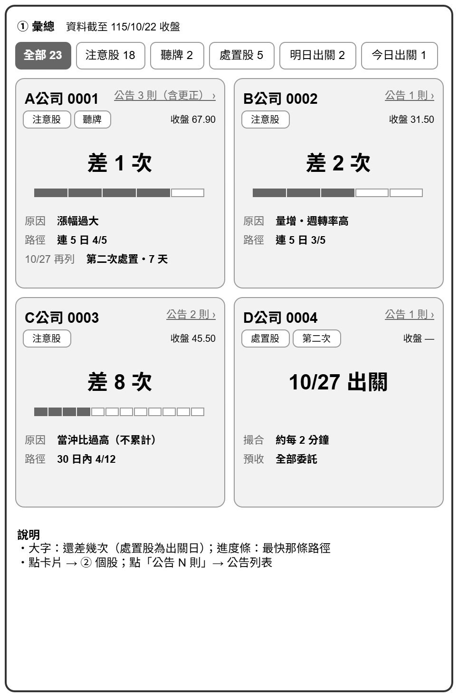
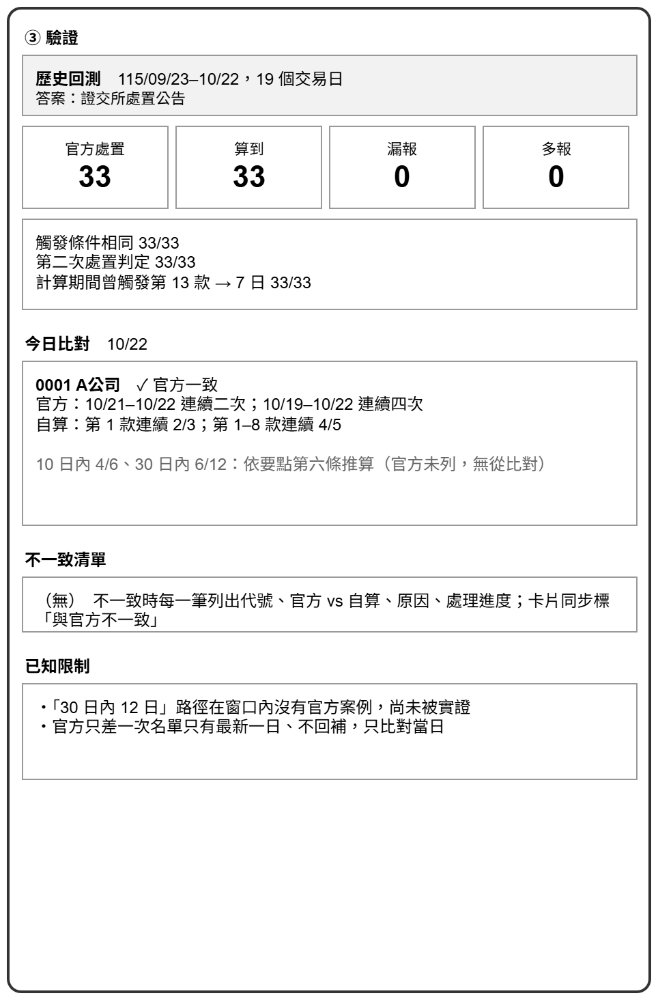
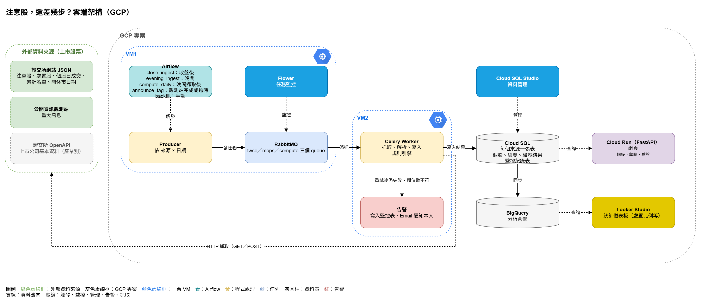

# 專題提案：注意股，還差幾步？替注意股標出處置進度與事實依據

> 證交所告訴你哪檔被盯上；這裡告訴你還差幾步會被處置、每一步依據哪條規則，以及這段期間公司說了什麼。

---

## 1. 製作動機與業務問題

證交所每個交易日收盤後公布「注意股」。第 1–8 款的注意次數會累計，達到門檻就成為**處置股**：撮合變慢，大額委託（第二次處置為所有委託）要先預收款券。

**目標使用者：** 做短線、當沖或用融資的散戶，收盤後才看盤。自選股被列注意時，他晚上想知道：這次會不會累計？還差幾次會被處置？如果明天再被列注意，從哪天開始受限、限到哪天，部位要不要在明天收盤前處理？

**現況：** 規則寫在《作業要點》第六條；證交所只列「只差一次」的股票，而且沒有歷史；公司公告要到公開資訊觀測站逐家查。

**本專題要做的：** 每個交易日替每檔注意股與處置股產生一張卡片，只放**可指回原文的事實 tag**（注意款次、累計進度、處置條件與措施、公司公告）。每個累計數字列出計入的日期，並標示和官方名單的比對結果：**官方一致／依要點第六條推算／與官方不一致**。

| 指標 | 現況 | 目標 |
| --- | --- | --- |
| 要查的地方 | 4 處（要點、證交所兩個頁面、觀測站逐家） | 1 張卡片 |
| 累計進度的可檢查性 | 官方只列只差一次的股票 | 每個數字列出日期與款次，並標示驗證狀態 |
| 產出時間 | — | 每個交易日 XX:XX 前更新（待第 0 週實測後填入） |

---

## 2. 資料來源（input）

範圍限**上市公司股票**，排除 ETF、ETN、受益證券等非公司證券。每日與回補使用同一支帶日期的網址。

| 來源 | 端點 | 用途 |
| --- | --- | --- |
| 注意股 | 證交所 `/rwd/zh/announcement/notice` | 輸入清單、注意款次、累計計算 |
| 處置股 | 證交所 `/rwd/zh/announcement/punish` | 處置 tag、歷史回測答案 |
| 注意累計次數可能達處置標準 | 證交所 `/rwd/zh/announcement/notetrans` | 每日驗證答案（只有最新一日） |
| 市場開休市日期 | 證交所 `/rwd/zh/holidaySchedule/holidaySchedule` | 交易日曆 |
| 個股日成交 | 證交所 `/rwd/zh/afterTrading/MI_INDEX` | 實際交易日判定、收盤價 |
| 重大訊息 | 觀測站 `POST /mops/api/t05st01` | 公司公告 tag（一次一家公司、一個月） |
| 上市公司基本資料 | 證交所 OpenAPI `/opendata/t187ap03_L` | 公司股票判定、產業別 |

---

## 3. 資料取得方式

所有來源皆以 HTTP 取得 JSON，不需登入。

| 任務 | 每日 | 回補（114/11 中–115/10） |
| --- | --- | --- |
| 注意股、處置股 | 各 1 次 | 各 1 次（帶整段日期） |
| 注意累計名單 | 1 次 | 不回補，只用當日結果 |
| 個股日成交 | 1 次 | 約 220 次 |
| 重大訊息 | 關注名單每家查當月，約 25–60 次；舊月份從資料庫取 | 每個（公司, 月份）1 次 |
| 開休市日期 | 每年 1 次 | 1–2 次 |
| 上市公司基本資料 | 每週 1 次 | 1 次 |

* 回補往前多抓 30 個營業日，供「30 日內 12 次」計算
* 注意股收盤後公布，處置股與累計名單較晚 → 每天分兩段執行

---

## 4. 欄位與格式

| 來源 | 取用欄位 | 唯一鍵 | 解析重點 |
| --- | --- | --- | --- |
| 注意股 | 證券代號、注意交易資訊、日期 | 日期＋代號；款次另存一對多表 | 款次標記 `﹝第X款﹞` 在句尾，一個標記涵蓋前面數句；JSON 的「累計次數」不是真實累計 |
| 處置股 | 公布日期、代號、處置條件、起迄時間、措施、內容 | 公布日期＋代號 | 撮合間隔、預收條件要從全文解析；不含觸發款次 |
| 注意累計名單 | 全部欄位 | 資料日期＋代號 | 一檔可列多條路徑，以 ` ` 分隔 |
| 重大訊息 | 代號、發言日期與時間、主旨、序號 | 代號＋發言日期＋序號 | 一天可發多則，序號不一定連續 |
| 開休市日期 | 日期 | 日期 | 只列預定休市日，臨時休市不在表內 |
| 個股日成交 | `stat`、代號、收盤價 | 日期＋代號 | 取「每日收盤行情」那張表 |
| 上市公司基本資料 | 代號、簡稱、產業別 | 代號（整表覆寫） | 只有現行上市公司 |

---

## 5. 預期產出（output）

畫面線框的數字為 115/10/22 收盤後的原型實測資料（公司名稱與代號為示意），版面以實作為準。

**產出 1：個股**

| 項目 | 內容（A公司 0001，115/10/22） | 事實來源 |
| --- | --- | --- |
| 今日注意款次 | 漲幅過大（第 1 款）、長期漲幅過大（第 2 款）→ 會累計 | 注意股 |
| 累計進度 | 連 3 日 2/3、連 5 日 4/5（官方一致）；10 日內 4/6、30 日內 6/12（推算） | 規則引擎；官方 10/22 名單 |
| 若 10/27 再列注意 | 10/28–11/05 第二次處置，全部委託預收；11/06 恢復正常交易 | 要點第六條；處置股；開休市日期 |
| 處置紀錄 | 10/06–10/13 第一次處置，約每 2 分鐘撮合，單筆 10 張或累積 30 張預收 | 處置股 |
| 公司公告（近 30 個營業日） | 3 則（含更正），各標交易時段內／後、更正、說明公告 | 觀測站 |

**定義規則：**

* 注意款次：第 1–8 款標「會累計」，第 9–14 款標「本次不累計」
* 累計進度：四條路徑各算「已達／門檻」，列出計入與排除的日期
* 驗證狀態：官方一致／依要點第六條推算（卡片上簡寫「推算」）／與官方不一致
* 次一營業日再列注意：換算成實際日期，每日重算，遇臨時休市順延
* 公司公告：近 30 個營業日的全部重大訊息；以 14:30 區分「交易時段內／後」；說明公告、更正各自標記，都計入則數

**產出 2：彙總**

* 每間公司一張卡片；分頁：全部、注意股、聽牌、處置股、明日出關、今日出關

**產出 3：驗證**

* 每日比對：「只差一次」名單 vs 官方注意累計名單；次一營業日處置名單 vs 官方處置公告
* 卡片標示驗證狀態；驗證頁列出當日不一致的個股與原因；不一致時告警給開發者
* 歷史回測：以 115 年 1–10 月處置公告回測規則引擎

**產出 4：統計儀表板（本機 Metabase，上雲後 Looker Studio）**

* 每月注意筆數中，會累計與不會累計的比例
* 各款次的注意股，後來進入處置的比例
* 有無公司公告的注意股，進入處置的比例
* 產業分布

**不做的事：** 不預測漲跌、不推薦買賣、不計算觸發價、不判斷是否涉及炒作；「若再列注意」只說明規則的後果。

---

## 6. 初步技術堆疊

本專題以完整實作課程工具鏈為目標，部分工具以目前資料量並非必要。

| 環節 | 工具（課程） | 在本題負責的工作 |
| --- | --- | --- |
| 開發環境 | WSL 2、uv、Docker Compose | 本機與雲端用同一份 compose 啟動 |
| 擷取 | requests、pandas、Celery、RabbitMQ（手冊01-04） | 觀測站逐家逐月查詢（回補上千次）：佇列限速、失敗重派；規則引擎也以一個任務在 worker 執行 |
| 監控與管理 | Flower、phpMyAdmin（手冊07）→ 雲端改用 Cloud SQL Studio | 追蹤失敗的任務；查看資料表 |
| 交易型資料庫 | MySQL（手冊05-06）→ Cloud SQL（手冊16） | raw 表冪等 upsert；卡片網站讀取結果表 |
| 排程 | Airflow（手冊10-12、17） | 兩段排程；送出規則引擎任務並等待完成；等待觀測站任務（含逾時） |
| 規則引擎 | Python（pandas） | 連續營業日、滾動窗口、前次處置扣除；包成一個 Celery 任務，本機與雲端共用 |
| 分析型資料庫 | BigQuery（手冊15） | 從 Cloud SQL 同步，供儀表板彙總查詢；示範交易型與分析型分工（僅雲端） |
| 卡片網站 | FastAPI + uvicorn（補充E）→ 雲端改用 Cloud Run（補充H） | 個股、彙總、驗證三個頁面 |
| 儀表板 | Metabase（手冊08）→ Looker Studio（手冊15） | 統計儀表板 |
| 上雲 | GCE VM（手冊14、16）、Secret Manager（手冊16） | VM1 跑 Airflow、RabbitMQ、Flower；VM2 跑 worker；資料庫密碼交給 Secret Manager。若雲端 IP 被擋，改為抓取在本機（補充L 雲地混合） |
| 品質 | pytest（補充F） | 款次與處置內容解析、規則引擎（以處置公告為答案）、重跑筆數不變 |

---

## 7. 流程圖與 Pipeline 規劃

**地端架構（11 月，桌機 WSL 2 + Docker Compose）**

**雲端架構（12 月，GCP）**

**每日流程：**

1. **收盤後**：確認交易日 → 抓個股日成交（全市場查無資料即判定臨時休市，當日停止）→ 抓注意股 → 對關注名單（注意股＋處置中）發觀測站任務
2. **晚間**：抓處置股、注意累計名單 → 送出規則引擎任務，worker 產生累計進度、處置 tag、驗證結果（不等觀測站）
3. 觀測站任務全部完成或逾時 → 產生公告 tag；逾時則標示「公告資料不完整」並告警
4. FastAPI 讀結果表產生網頁；雲端另將 Cloud SQL 同步到 BigQuery，供 Looker Studio 使用

**關鍵設計：**

* **每日＝回補一天**：同一套任務只差日期；各來源有唯一鍵，重跑筆數不變
* **raw 與計算分層**：規則改了從 raw 重算，不必重抓
* **錯誤分三種**：逾時、限流 → retry；臨時休市 → 不告警；其餘失敗 → 告警
* **Airflow 只做編排**：DAG 觸發 Producer 送出任務，抓取與規則引擎都在 worker 執行（補充J、手冊12 串法二）

---

## 8. 預期風險與每週進度

| 風險 | 對策 |
| --- | --- |
| 規則細節與官方做法不同 | 第 2 週用處置公告回測，不一致逐筆查原文、修規則並寫成測試 |
| 觀測站限流門檻未知 | Celery 逐筆限速、失敗重試 |
| 網站 JSON 無正式文件、可能改版 | 依欄名解析；欄位數不符即告警 |
| 注意累計名單沒有歷史 | 只用當日結果；歷史驗證改用處置公告 |
| 8/10 制度修正 | 規則依日期套用新舊版本；儀表板標出分界線 |
| Airflow、GCP 晚於專題開始才教 | 先用 Windows 工作排程器，預留接口 |
| 雲端費用 | 設預算警告；VM、Cloud SQL 不用就關 |

**範圍優先順序：** 目標是全部完成；進度落後時先保護核心。

* **必須完成**：注意股、處置股入庫 → 規則引擎（累計進度、處置 tag、驗證狀態）→ 卡片頁與卡片牆
* **依序延後**：統計儀表板 → BigQuery／Looker Studio → 觀測站公告 tag

| 週次 | 期間 | 目標 | 完成標準 |
| --- | --- | --- | --- |
| 0 | 10/24–11/6 | 資料源實測（含公布時間）、手動做 5 檔卡片、款次解析、repo 建立、雲端 IP 實測 | 7 個來源實測完成（10/25 ✅）；款次解析通過 1–14 款測試 |
| 1 | 11/7–11/14 | 注意股、處置股、日成交、開休市日期回補入 MySQL；Docker Compose | clean clone 一鍵啟動；重跑兩次筆數不變 |
| 2 | 11/15–11/21 | 規則引擎、處置內容解析、處置公告回測 | 一致率 ≥ 95%，不一致逐筆附原因 |
| 3 | 11/22–11/28 | Celery + RabbitMQ 抓觀測站、回補；公告 tag | 模擬失敗會重試；回補完成 |
| 4 | 11/29–12/5 | Airflow 排程、驗證狀態與驗證頁、Metabase；報告骨架 | DAG 連續數日成功；非開發者看得懂卡片 |
| 5 | 12/6–12/12 | 上 GCP（VM、Cloud SQL、BigQuery、Looker Studio） | 每日資料線在雲端跑通 |
| 6 | 12/13–12/19 | 功能凍結、修 bug、報告初稿 | README 可完整重現 |
| 7 | 12/20–12/26 | Demo 彩排、驗收 | Demo 有錄影備案 |

**未來延伸：** 原因分類（三大法人、融資融券）、上櫃、集保股權分散、處置期間的成交變化。
