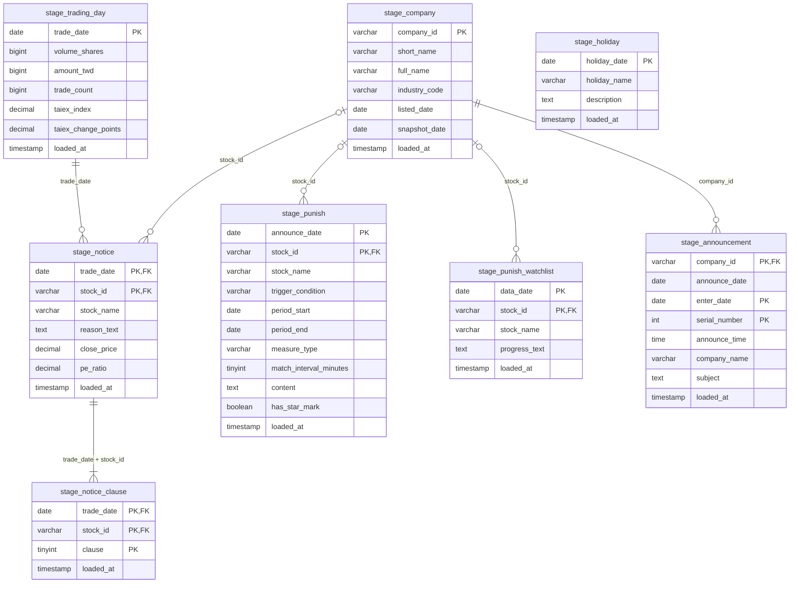

# 資料表說明

stage 層（`stage_*`）：raw 解析後的乾淨資料，不做業務判斷。每次從全部 raw 重算、整張表換掉。
建表 SQL 見 [`db/init/01_stage.sql`](../db/init/01_stage.sql)；每張表另有 `loaded_at`（寫入時間）。期間為 2026/11/14 的資料。

## 總覽

| 表 | 一列是 | 主鍵 | 期間 |
|---|---|---|---|
| `stage_notice` | 某天某檔的注意股 | trade_date, stock_id | 10/01–11/13 |
| `stage_notice_clause` | 某天某檔的一個款次 | trade_date, stock_id, clause | 10/01–11/13 |
| `stage_punish` | 一則處置公告 | announce_date, stock_id | 09/18–11/10（含 10/01 仍在處置中的；11/11 後無新公告） |
| `stage_punish_watchlist` | 官方注意累計名單的一檔 | data_date, stock_id | 11/09–11/13（API 只有最新一天，11/09 開始每天抓） |
| `stage_trading_day` | 一個有交易的日子 | trade_date | 10/01–11/13 |
| `stage_holiday` | 官方開休市日期的一天 | holiday_date | 2026 全年 |
| `stage_company` | 一家上市公司 | company_id | 11/13 快照 |
| `stage_announcement` | 一則重大訊息 | company_id, enter_date, serial_number | 09/01–11/13 |

## 關聯圖

- PK＝主鍵，FK＝關聯到另一張表的欄位；關聯是邏輯上的，資料庫沒設 FK。

## 欄位

「API 欄位」是資料列裡的欄位名稱；證交所的資料列是陣列，名稱在 `fields`（觀測站在 `result.titles`）。依欄名取值：官方多加欄位、調整順序都不影響，用到的欄位不見了 T 才會報錯。轉換規則在 `pipeline/transform/rules.py`。

### stage_notice　注意股

- 來源：證交所 `GET /rwd/zh/announcement/notice` → `data`
- 沒用到：編號、累計次數（不是個股的累計次數）

| 欄位 | 型別 | API 欄位 | 轉換／說明 |
|---|---|---|---|
| trade_date | DATE | 日期 | 民國 → 西元 |
| stock_id | VARCHAR(10) | 證券代號 | — |
| stock_name | VARCHAR(50) | 證券名稱 | — |
| reason_text | TEXT | 注意交易資訊 | 去 HTML |
| close_price | DECIMAL(12,4) | 收盤價 | 文字 → 數字 |
| pe_ratio | DECIMAL(12,4) | 本益比 | 文字 → 數字；沒有為 NULL |

### stage_notice_clause　注意款次

- 來源：`stage_notice` 的注意交易資訊

| 欄位 | 型別 | API 欄位 | 轉換／說明 |
|---|---|---|---|
| trade_date | DATE | 日期 | 民國 → 西元 |
| stock_id | VARCHAR(10) | 證券代號 | — |
| clause | TINYINT | 注意交易資訊 | 每個「第X款」一列，1～14 |

- 第 1–8 款會累計，第 9–14 款不累計。找不到款次時 T 會報錯。

### stage_punish　處置股

- 來源：證交所 `GET /rwd/zh/announcement/punish`（當天～當天＋14 天）→ `data`
- 沒用到：編號、累計、備註

| 欄位 | 型別 | API 欄位 | 轉換／說明 |
|---|---|---|---|
| announce_date | DATE | 公布日期 | 民國 → 西元（去掉 *） |
| stock_id | VARCHAR(10) | 證券代號 | — |
| stock_name | VARCHAR(50) | 證券名稱 | — |
| trigger_condition | VARCHAR(50) | 處置條件 | 例如「連續三次」 |
| period_start | DATE | 處置起迄時間 | `～` 前半，民國 → 西元 |
| period_end | DATE | 處置起迄時間 | `～` 後半，民國 → 西元 |
| measure_type | VARCHAR(20) | 處置措施 | 第一次／第二次處置 |
| match_interval_minutes | TINYINT | 處置內容 | 抓「約每X分鐘」；沒寫為 NULL |
| content | TEXT | 處置內容 | — |
| has_star_mark | BOOLEAN | 公布日期 | 是否以 * 開頭（意義未確認） |

- 同一則公告每天都會查到，依主鍵去重，留最後抓到的。
- API 篩的是處置期間，所以公布日期會比抓取期間早；回測要往前多抓幾週。

### stage_punish_watchlist　注意累計名單

- 來源：證交所 `GET /rwd/zh/announcement/notetrans` → `data`
- 沒用到：編號

| 欄位 | 型別 | API 欄位 | 轉換／說明 |
|---|---|---|---|
| data_date | DATE | `title` | 取標題裡的日期，民國 → 西元 |
| stock_id | VARCHAR(10) | 證券代號 | — |
| stock_name | VARCHAR(50) | 證券名稱 | — |
| progress_text | TEXT | 近期達本公司「公布注意交易資訊」標準之情形 | ` ` → 換行，去 HTML |

- 官方答案，用來驗證規則引擎的「只差一次」。

### stage_trading_day　交易日

- 來源：證交所 `GET /rwd/zh/afterTrading/FMTQIK`（一次一個月）→ `data`

| 欄位 | 型別 | API 欄位 | 轉換／說明 |
|---|---|---|---|
| trade_date | DATE | 日期 | 民國 → 西元 |
| volume_shares | BIGINT | 成交股數 | 文字 → 數字 |
| amount_twd | BIGINT | 成交金額 | 文字 → 數字（元） |
| trade_count | BIGINT | 成交筆數 | 文字 → 數字 |
| taiex_index | DECIMAL(12,2) | 發行量加權股價指數 | 文字 → 數字 |
| taiex_change_points | DECIMAL(12,2) | 漲跌點數 | 文字 → 數字 |

- 以實際成交為準，臨時休市也正確；「連續營業日」用這張表。

### stage_holiday　開休市日期

- 來源：證交所 `GET /rwd/zh/holidaySchedule/holidaySchedule`（`date`＝那年 1 月 1 日）→ `data`

| 欄位 | 型別 | API 欄位 | 轉換／說明 |
|---|---|---|---|
| holiday_date | DATE | 日期 | 本來就是西元 |
| holiday_name | VARCHAR(100) | 名稱 | — |
| description | TEXT | 說明 | — |

- 也含「開始交易日」這類有交易的日子；不含臨時休市。
- 年份要用 `date` 指定，`queryYear` 會被忽略。

### stage_company　上市公司

- 來源：證交所 OpenAPI `GET /v1/opendata/t187ap03_L` → 整個清單，只讀最新一份
- 沒用到：其餘 28 個欄位

| 欄位 | 型別 | API 欄位 | 轉換／說明 |
|---|---|---|---|
| company_id | VARCHAR(10) | 公司代號 | — |
| short_name | VARCHAR(50) | 公司簡稱 | — |
| full_name | VARCHAR(200) | 公司名稱 | — |
| industry_code | VARCHAR(10) | 產業別 | — |
| listed_date | DATE | 上市日期 | 本來就是西元 |
| snapshot_date | DATE | `meta.key` | raw 檔的抓取日期 |

- 只有現行上市公司。
- 含少數 DR（台灣存託憑證：外國公司在台上市的憑證，代號 91 開頭 6 碼，例如 `911868 同方友友-DR`）。

### stage_announcement　重大訊息

- 來源：觀測站 `POST /mops/api/t05st01`（一家公司一個月）→ `result.data`
- `code` 406＝那個月沒有公告

| 欄位 | 型別 | API 欄位 | 轉換／說明 |
|---|---|---|---|
| company_id | VARCHAR(10) | 公司代號 | — |
| announce_date | DATE | 發言日期 | 民國 → 西元 |
| enter_date | DATE | 詳細資料 的 `parameters.enterDate` | `1151102` → 日期；輸入日期 |
| serial_number | INT | 詳細資料 的 `parameters.serialNumber` | 輸入日期當天第幾則 |
| announce_time | TIME | 發言時間 | 判斷收盤前／後 |
| company_name | VARCHAR(50) | 公司名稱 | — |
| subject | TEXT | 主旨 | 接回被換行切斷的字 |

- 只有被列注意或處置的公司，查當月和上個月。
- 序號依輸入日期編，同一天發言的公告可能同號，所以主鍵用 enter_date。
